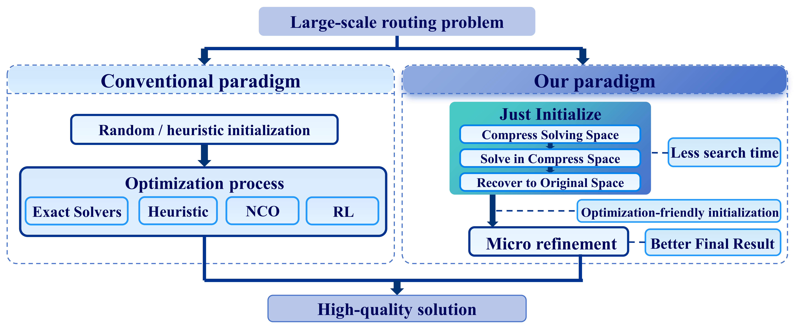

# Just Initialize: A Training-Free Initialization Component for Large-Scale Routing Optimization

This repository contains the implementation and benchmark materials for **Just Initialize (JI)**, a training-free initialization framework for large-scale routing problems. It supports the **Traveling Salesman Problem (TSP)**, **Capacitated Vehicle Routing Problem (CVRP)**, **Prize-Collecting TSP (PCTSP)**, and **Vehicle Routing Problem with Time Windows (VRPTW)**.

## Introduction

A useful starting solution can substantially reduce the work required by downstream optimization. JI compresses a routing instance into a compact surrogate space, searches for a promising global structure, and recovers an initialization in the original space. Lightweight, problem-specific refinement then improves this initialization.



### Highlights

- **Training-free:** runs directly on an instance without model training or pretrained weights.
- **Four routing problems:** a shared pipeline combines common search and recovery mechanisms with problem-specific constraints and refinement operators.
- **Downstream-guided search:** compact candidates are assessed by their objective after recovery and bounded original-space refinement.
- **Structure-aware recovery:** geometric and sequence consistency guide feasible recovery through Boltzmann sampling.
- **Large-scale benchmarks:** deterministic synthetic suites and public library instances cover scales up to 100,000 nodes.

## Framework


The implementation exposes four stages:

1. **Compress:** form compact units while retaining the information needed to recover original nodes.
2. **Solve:** construct and improve a compact plan. A surrogate objective shortlists candidates; recovered and refined objectives guide acceptance.
3. **Restore:** generate feasible original-space candidates and sample using their structural consistency scores.
4. **Optimize:** apply the problem-specific micro refinement to the recovered initialization.

The shared implementation lives in `src/core/`. Each problem implements its compression and final refinement through the interface in `src/problems/base.py`.

| Problem | Compression | Final refinement |
|---|---|---|
| TSP | Greedy path fragments | Iterated local search with 2-opt, Or-opt, and 3-opt |
| CVRP | Clarke–Wright routes split into fragments | Inter-route exchange and 2-opt |
| PCTSP | Spatial partitions | Spatial 2-opt and node insertion/removal |
| VRPTW | Spatial and temporal grouping of feasible routes | Feasible 2-opt, relocate, tail exchange, and route elimination |

## Repository Structure

```text
JI-main/
├── README.md
├── pyproject.toml              # Package metadata and dependencies
├── requirements.txt            # Pinned core dependency versions
├── requirements-data.txt       # Core versions plus optional TSP data generation
├── assets/
│   ├── intro.png
│   └── overview.png
├── src/
│   ├── __init__.py             # Public API exports
│   ├── api.py                  # Solver entry points
│   ├── io.py                   # Instance detection and loading
│   ├── core/                   # Shared compact search and recovery
│   │   ├── representation.py
│   │   ├── geometry.py
│   │   ├── oracle.py
│   │   ├── pipeline.py
│   │   ├── recovery.py
│   │   └── refinement.py
│   └── problems/               # Problem interface and implementations
│       ├── base.py
│       ├── tsp.py
│       ├── cvrp.py
│       ├── pctsp.py
│       └── vrptw.py
├── benchmarks/
│   ├── evaluate.py             # Sequential evaluation and independent validation
│   ├── run_parallel.py         # Parallel evaluation
│   ├── export_csv.py           # Per-run and per-instance CSV export
│   └── smoke_test.py           # Small offline correctness checks
├── data/
│   └── <problem>/              # tsp, cvrp, pctsp, or vrptw
│       ├── generate_instances.py
│       ├── instances/          # Solver-ready instance files
│       ├── seed/               # Seed records and generation metadata
│       ├── bks/                # Reference objective values
│       └── manifest.csv        # Instance index, generated by the data script
└── results/                    # Local evaluation results, ignored by Git
```

CVRP, PCTSP, and VRPTW generators also write floating-point source arrays to `data/<problem>/canonical/` before exporting solver-ready instances.

## Installation

Run all commands below from the repository root, preferably in a virtual environment.
Create and activate one before installing:

```powershell
# Windows PowerShell
py -3.13 -m venv .venv
.\.venv\Scripts\Activate.ps1
```

```bash
# Linux / macOS
python3.13 -m venv .venv
source .venv/bin/activate
```

If PowerShell blocks activation, use `.\.venv\Scripts\python.exe` in place of
`python` in the commands below; activation is not required.

The pinned dependencies in `requirements.txt` require **Python 3.11 or later**;
the verified core environment is **Windows / CPython 3.13.1**.

| Dependency | Pinned version | Purpose |
|---|---|---|
| NumPy | 2.2.4 | Numerical arrays |
| SciPy | 1.16.0 | Spatial search |
| Numba | 0.65.1 | CPU compilation |
| llvmlite | 0.47.0 | Numba compiler dependency |
| PyTorch (optional) | 2.9.0 | TSP data generation |

Install the pinned core dependencies and the package:

```bash
python -m pip install -r requirements.txt
python -m pip install -e .
```

The solver uses **NumPy, SciPy, and Numba** and runs on the CPU. To regenerate the TSP datasets, install the optional **PyTorch** dependency:

```bash
python -m pip install -r requirements-data.txt
```

PyTorch is not needed to solve instances or generate the CVRP, PCTSP, and VRPTW
datasets. The data generator uses CPU tensors and does not require CUDA.
The optional requirements file was verified with PyTorch `2.9.0+cpu` in the
fresh Windows environment.

These files record dependency versions, rather than a full platform-specific lock.
The package itself declares Python >=3.10: on Python 3.10, use
`python -m pip install -e .` (or `python -m pip install -e ".[data]"` for TSP
generation) to resolve compatible versions instead of the pinned files above.
That alternative environment has not been verified here.

Fresh-environment validation on Windows / CPython 3.13.1 covered installation of
the pinned core dependencies and editable package, `pip check`, both evaluation
CLI help commands, the 100-node Python API example, and actual solving of TSP,
CVRP, PCTSP, and VRPTW instances. The optional data dependencies also installed
successfully; all four TSP generation distributions passed small-instance checks
with repeatable seeds. This was a functional installation check, not
a rerun of the full benchmark. Linux and macOS installation have not been
verified here.

## Quick Start

Evaluate a bundled public benchmark instance:

```bash
python benchmarks/evaluate.py --problem tsp --instance pr1002
python benchmarks/evaluate.py --problem cvrp --instance X-n1001-k43
```

Evaluate a uniform 10k suite:

```bash
python benchmarks/evaluate.py --problem tsp --suite uniform --scale 10000
python benchmarks/evaluate.py --problem cvrp --suite uniform --scale 10000
python benchmarks/evaluate.py --problem pctsp --suite uniform --scale 10000
python benchmarks/evaluate.py --problem vrptw --suite uniform --scale 10000
```

Each selected instance is run **three times**, with the complete solution and independently checked objective saved for every run. If synthetic instances are absent, generate them as described below first.

## Datasets

| Problem | Suite | Sizes | Instances |
|---|---|---|---:|
| TSP | Uniform | 5k, 10k, 20k, 50k, 100k; 16 per size | 80 |
| TSP | Clustered, explosion, implosion | 10k and 100k; 16 per distribution and size | 96 |
| TSP | TSPLIB | 32 selected public instances | 32 |
| CVRP | Uniform | 5k, 10k, 20k, 50k, 100k; 16 per size | 80 |
| CVRP | CVRPLIB | 11 selected public instances | 11 |
| PCTSP | Uniform | 2k, 5k, 10k: 16 per size; 20k: 8 | 56 |
| VRPTW | Uniform | 2k, 5k, 10k: 16 per size; 20k: 8 | 56 |

The complete benchmark contains **411 instances**. TSP sizes count cities; CVRP, PCTSP, and VRPTW synthetic sizes count customers, with the depot stored separately or as an additional node.

### Data sources

- **Public TSP instances:** the 32 bundled instances are from
  [TSPLIB](https://wwwproxy.iwr.uni-heidelberg.de/groups/comopt/software/TSPLIB95/).
  Their reference objectives are recorded in `data/tsp/bks/tsplib_bks.json`.
- **Public CVRP instances:** the 11 bundled instances are from
  [CVRPLIB](https://galgos.inf.puc-rio.br/cvrplib/en/instances/1).
  `data/cvrp/bks/cvrplib_reference.json` records the individual download URLs,
  retrieval date, reference solution values, and file hashes.
- **Synthetic TSP:** uniform points are generated locally. The clustered,
  explosion, and implosion distributions follow the official
  [INViT implementation](https://github.com/Kasumigaoka-Utaha/INViT), with reference
  commit `f11a6024870036f5d7a7826e0955bd4e6dd350dd` recorded in the generator.
  Coordinates are normalized and exported on a 1,000,000-scale integer grid.
- **Synthetic CVRP and PCTSP:** generated locally by the supplied scripts;
  instance sizes, distributions, constraints, and seeds are recorded under
  `data/<problem>/seed/`.
- **Synthetic VRPTW:** generated locally using the time-window convention of
  [MVMoE](https://github.com/RoyalSkye/Routing-MVMoE), with depot horizon `[0, 3]`
  and a feasibility rejection step. Coordinates, time windows, and service times
  are exported at the same integer scale.

Synthetic suites are generated instances, not downloaded copies of the public
libraries. Reference objectives and their available solver/protocol metadata live
under `data/<problem>/bks/`; empirical reference values are not claimed as optima.

### Generate synthetic instances

Synthetic instance files may be omitted from a Git checkout or a size-limited supplementary archive. The generators and seed records are provided to regenerate them under `data/<problem>/instances/`:

```bash
python data/tsp/generate_instances.py
python data/cvrp/generate_instances.py
python data/pctsp/generate_instances.py
python data/vrptw/generate_instances.py
```

These commands regenerate the synthetic suites and their manifests. Public TSPLIB and CVRPLIB files are supplied separately in their respective `instances/` subdirectories and are not generated by these scripts. Full generation includes 100k-node instances and requires sufficient disk space.

VRPTW also supports generating a selected size while retaining other manifest entries:

```bash
python data/vrptw/generate_instances.py --sizes 2000
```

## Full Evaluation

Run all suites for each problem sequentially:

```bash
python benchmarks/evaluate.py --problem tsp --all --model ji_full
python benchmarks/evaluate.py --problem cvrp --all --model ji_full
python benchmarks/evaluate.py --problem pctsp --all --model ji_full
python benchmarks/evaluate.py --problem vrptw --all --model ji_full
```

Use sequential evaluation for runtime comparisons. For higher throughput, evaluate a complete problem in parallel:

```bash
python benchmarks/run_parallel.py --problem tsp --workers 8 --model ji_parallel
```

Parallel workers contend for CPU resources, so their timings should be reported separately from sequential timings.

| Option | Purpose |
|---|---|
| `--problem` | Choose `tsp`, `cvrp`, `pctsp`, or `vrptw` |
| `--instance` | Select an instance by its name; repeat to select several |
| `--suite` | Select `uniform`, a TSP distribution, `tsplib`, or `cvrplib`, as applicable |
| `--scale` | Filter the selected instances by benchmark size |
| `--all` | Select all instances for the problem |
| `--model` | Set the result folder label; the default is `src` |
| `--solver` | Load an alternative module with the same solver and reader API |

The selection options `--instance`, `--suite`, `--scale`, and `--all` belong to `evaluate.py`. The parallel launcher runs the complete problem and additionally accepts `--workers`. Both programs rerun all three repetitions for every selected instance and overwrite its existing run files under the same result label. There is no automatic resume or skip-existing behavior. **Use a new `--model` label to preserve previous results when changing code, settings, or hardware.** Results for unselected instances remain in place and are included in the summaries.

## Python API

Solve a TSP directly from coordinates:

```python
import numpy as np
import src as ji

points = np.random.default_rng(0).integers(0, 10000, size=(100, 2))
tour = ji.solve_tsp(points, seed=0)
```

Load and solve a supported instance file:

```python
import src as ji

routes = ji.solve_instance("data/cvrp/instances/cvrplib/X-n1001-k43.vrp", seed=0)
```

To obtain the initialization before final refinement, call the stages individually:

```python
import src as ji

kind, problem = ji.read_instance("data/tsp/instances/tsplib/u1060.tsp")
compact = ji.compress(kind, problem, seed=0)
plan = ji.solve(compact, ji.Oracle(compact))
initialization = ji.restore(plan, compact)
solution = ji.optimize(compact, initialization, seed=0)
```

The public solver functions are `solve_tsp`, `solve_cvrp`, `solve_problem` (PCTSP), `solve_vrptw`, and `solve_instance`. Returned node indices refer to the loaded problem arrays, rather than the one-based identifiers in text instance files. TSP returns a tour array; CVRP and VRPTW return lists of customer-index arrays; PCTSP returns a cycle starting and ending at depot index 0.

The unified `read_instance` API accepts `EUC_2D` text instances with the expected section delimiters; the final `EOF` marker is optional, including for bundled TSP files such as `pr1002.tsp`. The TSP evaluator also scores `CEIL_2D` library instances according to their declared distance convention, although `solve_tsp` internally uses `EUC_2D` distances.

## Results and Reproducibility

Each benchmark run writes a JSON file containing the complete solution, feasibility status, independently recomputed objective, reference gap, and runtime:

```text
results/details/<model>/<problem>/<suite>/<instance>/run_1.json
results/details/<model>/<problem>/<suite>/<instance>/run_2.json
results/details/<model>/<problem>/<suite>/<instance>/run_3.json
```

The evaluators additionally generate `results/summary.csv` and `results/summary/<problem>/<suite>.csv`, grouped by model, problem, suite, and scale. Their aggregate fields are `avg_score`, `mean_gap`, and `mean_time_s`.

Export or rebuild the per-run records and per-instance statistics from the detailed JSON files:

```bash
python benchmarks/export_csv.py
```

This writes `results/runs.csv` and `results/instance_summary.csv` without rerunning any solver. The latter includes `obj`, `avggap`, `avgtime`, repetition counts, completeness, and standard deviations. Objectives and gaps are averaged over valid runs; runtime includes all recorded attempts. `complete` checks whether repetitions 1, 2, and 3 are present; `valid_runs` separately reports solution validity. CSVs use UTF-8 with a BOM for spreadsheet compatibility.

To export a selected problem or model while preserving the full exports, use a separate output directory:

```bash
python benchmarks/export_csv.py --problem vrptw --output results/vrptw_export
```

Duplicate records and malformed inputs cause an error rather than silent double counting. Results are ignored by Git and may be absent from a fresh checkout.

Objectives are tour length for TSP, depot-inclusive total route length for CVRP and VRPTW, and route length plus omitted-node penalties for PCTSP. The reference gap is:

```text
gap (%) = 100 * (objective - reference) / reference
```

Reference records live in `data/<problem>/bks/`. Some references are empirical best-known values or upper bounds, rather than proven optima.

All current benchmark summaries and CSV exports use **end-to-end runtime**: instance loading, all four solver stages, and independent feasibility/objective validation. The timer starts immediately before the evaluator reads the instance and stops when it returns the checked solution. Reference lookup, result serialization, process startup, and warmup are outside this per-instance boundary. Both evaluators perform an untimed instance warmup; parallel evaluation warms up each worker. First-use compilation and startup latency should be reported separately from warmed timings.

New JSON records set `time_s = evaluation_time_s` and `time_scope = "loading_solving_validation"`. Historical full-experiment JSON files remain unchanged: they used `time_s` for solver-only runtime and `evaluation_time_s` for end-to-end runtime. Summary generation and CSV export prefer the historical `evaluation_time_s`; the exporter retains the old solver-only measurement in `solver_time_s`. Thus exported `avgtime` always means end-to-end runtime, including when old and new records are read together.

Fixed seeds control generation and recovery sampling. Time-limited refinement can produce different solutions across repeated runs or machines, even with the same seed. A refinement budget limits that stage, not the entire pipeline. For comparisons, record the code revision, dependencies, hardware, execution mode, timing definition, and all three runs.

The three repetitions use the same default solver seed (`0`); they are repeated runs of the same setting, not experiments with three different random seeds.


## Smoke Test

Run a small offline check before a full experiment:

```bash
python benchmarks/smoke_test.py
```

The check creates temporary 65-node fixtures for all four problems and exercises instance loading, solving, independent validation, failed-run recording, shared sequential/worker timing, and CSV statistics. It also checks historical timing conversion, missing repetitions, and duplicate-record rejection. It finishes with `SMOKE PASS` and never modifies the datasets or saved experiment results. Initial Numba compilation can make the first invocation slower. This is a functional check, not a full quality or performance benchmark.
